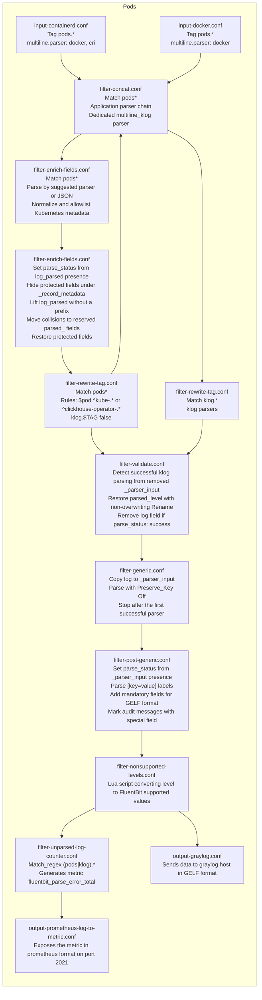

# 📄 Fluent Bit Pipeline Overview

This document describes the Fluent Bit pipeline used for log ingestion and parsing in the Qubership Logging Operator.
It supports multiple log formats and dynamically selects parsers based on pod annotations.

---

## Supported log formats

The pipeline parses Qubership, JSON, logfmt, and klog logs, and the native formats of several third-party components.
[Supported log formats](log-processing/log-formats.md) lists them, with the rules each parser applies and the order in
which FluentBit tries them.

## Parser selection

FluentBit picks a parser in two steps:

1. The Kubernetes filter parses the line with the parser that the pod's `fluentbit.io/parser` annotation names. Without
   the annotation, it parses the line as JSON if the line is a JSON object. A successful parse creates `log_parsed`,
   which marks the record as parsed and bypasses the generic parser chain. See
   [Choose a parser for a pod](log-processing/configure-parsing.md#choose-a-parser-for-a-pod).
2. For other records, FluentBit copies `log` to the reserved `_parser_input` field. Generic parsers use
   `Preserve_Key Off`, so the first successful parser removes `_parser_input`. The pipeline uses its absence to set
   `parse_status: success`. If every parser leaves `_parser_input` intact, the status remains `failed`.

Third-party parsers are selected by the pod or container name, never by the namespace, so a namespace such as
`pgadmin` does not select the PostgreSQL parser.

## Pipeline Design

### Multiline boundaries in mixed logs

Application multiline concatenation runs before JSON parsing. The default continuation rule excludes both
`[YYYY-MM-DD` headers and lines that begin with `{` after optional whitespace. This keeps JSON objects on separate
lines from being appended to preceding Java or Qubership messages. A line beginning with `{` inside a text message
also ends that multiline message.

The two-second multiline flush sends buffered content but does not reset the regex continuation state in Fluent Bit
5.1.1. JSON must be excluded from the continuation rule even when it arrives after a flush.

The chart supplies this rule through `fluentbit.multilineOtherLinesRegexp` and
`fluentbit.aggregator.multilineOtherLinesRegexp` in `LoggingService`. Updating only the operator image does not update
these stored values. Explicit custom regex overrides remain in effect.

### Pods flowchart

The application multiline filter tries `multiline_qubership`, Fluent Bit's built-in `java` and `go` parsers, and
`multiline_python`, in that order. The last parser follows Fluent Bit's Python rules, except that the terminal
exception moves the traceback to a closing state instead of `start_state`, which Fluent Bit 5.1 replays. The closing
state continues only on indented notes, so the next unindented message keeps a record of its own. The parser also
keeps a traceback whole when a frame has no source line, which Python omits when the source is unavailable, and when
Python 3.11 or later marks the failing expression with a line of `~` and `^`. This chain joins stack traces whose
first line does not use the Qubership bracketed timestamp layout, without expanding the configurable Qubership
expression.

### Detailed Pods parsing flow

<!-- textlint-disable -->
| #  | File                                          | Type/Action                                                                                                                 | Scope / Match                             | Purpose                                                                                                                                                                                                                                      |
| -- | --------------------------------------------- | --------------------------------------------------------------------------------------------------------------------------- | ----------------------------------------- | -------------------------------------------------------------------------------------------------------------------------------------------------------------------------------------------------------------------------------------------- |
| 1  | inputs/input-containerd.conf                  | INPUT Tail (multiline.parser docker, cri)                                                                                   | Tag pods.*                                | Reads containerd and CRI-O logs and decodes the Docker JSON or CRI line format                                                                                                                                                               |
| 2  | inputs/input-docker.conf                      | INPUT Tail (multiline.parser docker)                                                                                        | Tag pods.*                                | Reads docker logs and parses them with docker parser                                                                                                                                                                                         |
| 3  | filters/filter-concat.conf                    | FILTER multiline (Qubership, Java, Go, and Python parser chain)                                                             | Match pods*                               | Concatenates Qubership messages and language stack traces. The Qubership continuation rule excludes JSON records                                                                                                                             |
| 4  | filters/filter-concat.conf                    | FILTER multiline (multiline.parser multiline_klog)                                                                          | Match klog*                               | Concatenates messages based on klog trace messages format                                                                                                                                                                                    |
| 5  | filters/filter-enrich-fields.conf             | FILTER kubernetes (Regex_Parser kube-meta; Merge_Log_Key log_parsed)                                                        | Match pods*                               | Enriches messages with metadata. Parses log field with suggested parser in pod's annotations if provided, otherwise tries to parse with json parser. If message parsing succeeded saves parsed data in log_parsed field                      |
| 6  | filters/filter-enrich-fields.conf             | FILTER nest (Operation lift; Remove_prefix kubernetes.)                                                                     | Match pods*                               | Lifts fields nested under kubernetes to the root level                                                                                                                                                                                       |
| 7  | filters/filter-enrich-fields.conf             | FILTER modify (rename container_name and stream)                                                                            | Match pods*                               | Normalizes Kubernetes metadata names and preserves the CRI/Docker standard output stream under `stdio_stream`.                                                                                                                               |
| 8  | filters/filter-enrich-fields.conf             | FILTER record_modifier (allowlist pod and stdio_stream)                                                                     | Match pods*                               | Leaves only allowed fields in a record                                                                                                                                                                                                       |
| 9  | filters/filter-enrich-fields.conf             | FILTER modify (Set parse_status failed)                                                                                     | Match pods*                               | Initializes parsing status before checking whether the Kubernetes filter created `log_parsed`.                                                                                                                                               |
| 10 | filters/filter-enrich-fields.conf             | FILTER modify (Condition Key_exists log_parsed; Set parse_status success)                                                   | Match pods*                               | Marks records parsed by the Kubernetes filter without counting fields.                                                                                                                                                                       |
| 11 | filters/filter-enrich-fields.conf             | FILTER nest/modify/nest                                                                                                     | Match pods*                               | Removes the reserved `_record_metadata` object that an application payload supplies, through a temporary payload prefix.                                                                                                                     |
| 12 | filters/filter-enrich-fields.conf             | FILTER nest (Operation nest; Nest_under `_record_metadata`)                                                                 | Match pods*                               | Moves protected fields to the internal `_record_metadata` object while application fields are extracted.                                                                                                                                     |
| 13 | filters/filter-enrich-fields.conf             | FILTER nest (Operation lift; Nested_under log_parsed)                                                                       | Match pods*                               | Moves application fields from `log_parsed` to the root without changing their names.                                                                                                                                                         |
| 14 | filters/filter-enrich-fields.conf             | FILTER modify (Hard_rename namespace parsed_namespace; ...)                                                                 | Match pods*                               | Moves application fields that use protected names to their reserved `parsed_*` names.                                                                                                                                                        |
| 15 | filters/filter-enrich-fields.conf             | FILTER nest (Operation lift; Nested_under `_record_metadata`)                                                               | Match pods*                               | Restores authoritative metadata and other protected fields.                                                                                                                                                                                  |
| 16 | filters/filter-rewrite-tag.conf               | FILTER rewrite_tag (Rules $pod ^kube-.* and $pod ^clickhouse-operator-.*, klog.$TAG, false)                                 | Match pods*                               | Rewrites tag to klog.$TAG without preserving the original record. Sends the record to the pipeline beginning with the new tag                                                                                                                |
| 17 | filters/filter-rewrite-tag.conf               | FILTER modify (Copy log `_parser_input`)                                                                                    | Match klog*                               | Copies the source message to the reserved parser input field.                                                                                                                                                                                |
| 18 | filters/filter-rewrite-tag.conf               | FILTER parser (Parser klog_entry; Preserve_Key Off)                                                                         | Match klog*                               | Parses Kubernetes system logs and removes `_parser_input` on success.                                                                                                                                                                        |
| 19 | filters/filter-rewrite-tag.conf               | FILTER parser (Parser klog_trace_entry; Preserve_Key Off)                                                                   | Match klog*                               | Parses Kubernetes system trace logs and removes `_parser_input` on success.                                                                                                                                                                  |
| 20 | filters/filter-events-reader.conf             | FILTER modify; FILTER record_modifier                                                                                       | Pod or container name has `events-reader` | Renames `involvedObjectNamespace` to `namespace`, and removes `labels`, `pod`, and `container`                                                                                                                                               |
| 21 | filters/filter-validate.conf                  | FILTER modify (Condition Key_does_not_exist `_parser_input`)                                                                | Match klog*                               | Marks klog records as successfully parsed when a parser removed `_parser_input`.                                                                                                                                                             |
| 22 | filters/filter-validate.conf                  | FILTER modify (Remove invalid `__qubership_candidate`)                                                                      | Match pods*                               | Removes a payload-supplied marker when the raw log does not match the Qubership timestamp and severity header                                                                                                                                |
| 23 | filters/filter-validate.conf                  | FILTER modify (Set nc_audit_label true)                                                                                     | Pod or container name has `grafana`       | Marks messages from grafana containing specific text mentioned in Condition with `nc_audit_label: true`. Applies only to records the Kubernetes filter parsed (`parse_status: success`)                                                      |
| 24 | filters/filter-validate.conf                  | FILTER modify (Set nc_audit_label true)                                                                                     | Pod or container name has `mongo`         | Marks messages from mongo containing specific text mentioned in Condition with `nc_audit_label: true`. Applies only to records the Kubernetes filter parsed (`parse_status: success`)                                                        |
| 25 | filters/filter-validate.conf                  | FILTER modify (Set nc_audit_label true)                                                                                     | Match pods*                               | Marks messages containing specific text mentioned in Condition with `nc_audit_label: true`. Applies only to records the Kubernetes filter parsed (`parse_status: success`)                                                                   |
| 26 | filters/filter-validate.conf                  | FILTER modify (Condition Key_value_matches log ^\s*\{...\}\s*$; Set parse_format json); FILTER modify (Rename msg, message) | Match pods*                               | Marks a JSON record with `parse_format: json`, then moves `msg`, or else `message`, to `short_message` only when the field holds a non-empty string.                                                                                         |
| 27 | filters/filter-validate.conf                  | FILTER modify (Rename parsed_level level)                                                                                   | Match pods*                               | Restores the application `level` from `parsed_level` for every parsed format. `Rename` keeps an authoritative `level` when the record already carries one.                                                                                   |
| 28 | filters/filter-validate.conf                  | FILTER modify (Condition Key_value_matches parse_status success; Copy log short_message)                                    | Match_regex (pods\|klog).*                | If `parse_status` is `success`, copies `log` to `short_message` (if `short_message` does not exist yet) and renames `log` to `original_log`, which takes the record off the generic chain                                                    |
| 29 | filters/filter-generic.conf                   | FILTER modify (Copy log `_parser_input`); FILTER parser (Preserve_Key Off)                                                  | Match pods*                               | Runs generic parsers against `_parser_input`. The first successful parser removes the field, so the remaining parsers skip the record. The generalized Qubership parser also skips OpenSearch pod tags, which the OpenSearch parser handles. |
| 30 | filters/filter-post-generic.conf              | FILTER modify (Condition Key_does_not_exist `_parser_input`)                                                                | Match pods*                               | Marks a record as successfully parsed when a generic parser removed `_parser_input`.                                                                                                                                                         |
| 31 | filters/filter-post-generic.conf              | FILTER parser (Parser level_parser_common_keep)                                                                             | Match pods*                               | Tries to extract a log's severity level with the common level parser                                                                                                                                                                         |
| 32 | filters/filter-post-generic.conf              | FILTER modify (Set parse_format logfmt; Rename message fields)                                                              | Match pods*                               | Classifies successfully parsed logfmt records and normalizes their message and time fields                                                                                                                                                   |
| 33 | filters/filter-post-generic.conf              | FILTER modify (Set parse_format postgres)                                                                                   | Pod or container: `postgres\|patroni\|pg` | Classifies successfully parsed PostgreSQL records                                                                                                                                                                                            |
| 34 | filters/filter-post-generic.conf              | FILTER modify (Set parse_format consul)                                                                                     | Pod or container name has `consul`        | Classifies successfully parsed Consul records                                                                                                                                                                                                |
| 35 | filters/filter-post-generic.conf              | FILTER modify (Condition Key_value_matches log ^\s*\{...\}\s*$; Set parse_format json); FILTER modify (Rename msg, message) | Match pods*                               | Marks JSON that a generic parser parsed, Jaeger logs among them, with `parse_format: json`, then moves `msg`, or else `message`, to `short_message` only when the field holds a non-empty string.                                            |
| 36 | filters/filter-post-generic.conf              | FILTER modify (Remove invalid `__qubership_candidate`)                                                                      | Match pods*                               | Removes a payload-supplied marker when the raw log does not match the Qubership timestamp and severity header                                                                                                                                |
| 37 | filters/filter-post-generic.conf              | FILTER lua (Call kv_parse)                                                                                                  | Match pods*                               | Parses [key=value] labels when `__qubership_candidate` exists. Reads `log`, or `original_log` on records that row 28 took off the generic chain                                                                                              |
| 38 | filters/filter-post-generic.conf              | FILTER modify (Condition Key_value_matches log <regex_here>; Set nc_audit_label true)                                       | Pod or container name has `grafana`       | Marks messages from Grafana containing specific text with `nc_audit_label: true`                                                                                                                                                             |
| 39 | filters/filter-post-generic.conf              | FILTER modify (Condition Key_value_matches log <regex_here>; Set nc_audit_label true)                                       | Pod or container name has `mongo`         | Marks messages from MongoDB containing specific text with `nc_audit_label: true`                                                                                                                                                             |
| 40 | filters/filter-post-generic.conf              | FILTER modify (Condition Key_value_matches log <regex_here>; Set nc_audit_label true)                                       | Match pods*                               | Marks messages containing audit-related text with `nc_audit_label: true`                                                                                                                                                                     |
| 41 | filters/filter-post-generic.conf              | FILTER modify (Set parse_format logfmt; Rename message fields)                                                              | Match pods*                               | Normalizes message and time fields for remaining logfmt candidates that contain `msg`                                                                                                                                                        |
| 42 | filters/filter-post-generic.conf              | FILTER modify (Set parse_format qubership)                                                                                  | Match pods*                               | Classifies pod records that contain `__qubership_candidate` as Qubership logs                                                                                                                                                                |
| 43 | filters/filter-post-generic.conf              | FILTER modify (Set short_message `<Empty message>`)                                                                         | Match pods*                               | Adds a placeholder when a Qubership pod record has no `short_message`                                                                                                                                                                        |
| 44 | filters/filter-post-generic.conf              | FILTER modify (Copy log short_message)                                                                                      | Match_regex (pods\|klog).*                | Uses the raw `log` as a fallback when no parser or placeholder produced `short_message`                                                                                                                                                      |
| 45 | filters/filter-post-generic.conf              | FILTER record_modifier (Remove_key temporary and raw-log fields)                                                            | Match_regex (pods\|klog).*                | Removes `log`, `_parser_input`, `original_log`, `logfmt_candidate`, and `__qubership_candidate`                                                                                                                                              |
| 46 | filters/filter-post-generic.conf              | FILTER modify (Set hostname ${HOSTNAME})                                                                                    | Excludes built-in HTTP routing tags       | Adds the `hostname` field, sourced from a FluentBit pod's environment variable, required for the GELF format                                                                                                                                 |
| 47 | filters/filter-post-generic.conf              | FILTER modify (Set nodename ${NODE_NAME})                                                                                   | Excludes built-in HTTP routing tags       | Adds the `nodename` field, sourced from a FluentBit pod's environment variable, required for the GELF format                                                                                                                                 |
| 48 | filters/filter-nonsupported-levels.conf       | FILTER lua (Script /fluent-bit/etc/update_level_syslog.lua)                                                                 | Excludes built-in HTTP routing tags       | Converts `level` to FluentBit supported severity levels and sets `parse_level_unknown` as described below                                                                                                                                    |
| 49 | filters/filter-unparsed-log-counter.conf      | FILTER log_to_metrics (Regex parse_status ^failed$)                                                                         | Match_regex (pods\|klog).*                | Generates the prometheus metric `fluentbit_parse_error_total`                                                                                                                                                                                |
| 50 | outputs/output-graylog.conf                   | OUTPUT gelf                                                                                                                 | Match_regex (audit\|system\|pods\|klog).* | Sends data in GELF format to the Graylog host defined in the output config. The message goes to `short_message`; no `full_message` is set                                                                                                    |
| 51 | outputs/output-prometheus-log-to-metrics.conf | OUTPUT prometheus_exporter                                                                                                  | Match_regex (parse_error_metrics\|calico) | Exposes `fluentbit_parse_error_total` and `calico_syn_packets_total` on port `2021`                                                                                                                                                          |
| 52 | outputs/output-http.conf                      | OUTPUT http                                                                                                                 | Match *                                   | Sends data in json_lines format to HTTP storage backend (VictoriaLogs)                                                                                                                                                                       |
<!-- textlint-enable -->

`__qubership_candidate` is reserved for internal pipeline use. Before using this marker, the pipeline removes it when
the raw `log` does not match the Qubership timestamp and severity header. This prevents fields from JSON, logfmt, and
other parsed payloads from triggering Qubership classification. The pipeline removes the marker before output.

Records rewritten to `klog.*` originate from `kube-*` Kubernetes system pods and are outside the Qubership application
log format. Qubership marker interpretation and classification apply only to `pods*` records. On `klog.*` records,
`__qubership_candidate` is never trusted and is removed with the other temporary pipeline fields.

### Output fields

[Log fields reference](log-processing/log-fields.md) lists the fields every record carries, the internal and
reserved fields, and the level mapping.

When `output.http.routing.enabled` is `true`, level normalization excludes the built-in HTTP routing tags `out_audit`,
`out_k8s_event`, `out_nginx`, `out_access`, `out_int`, `out_pods`, `out_system`, and `out_default`. This prevents
HTTP-routed records from being normalized a second time and preserves values such as `detected_level="trace"`. Other
tags, including custom tags that start with `out_`, are normalized. When HTTP routing is disabled, the filter matches
every tag, so custom inputs that use one of the routing tag names keep level normalization.
